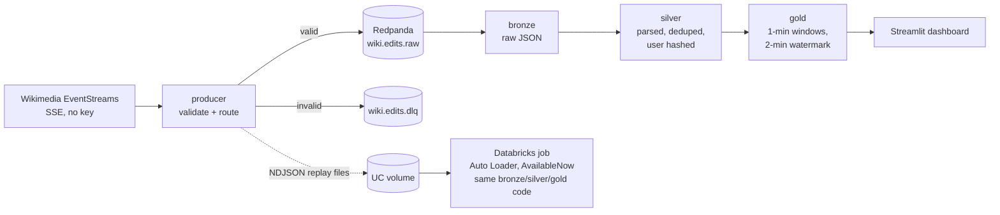

# Wikipedia live edits: a streaming lakehouse

Every edit made on any Wikipedia, worldwide, streamed live (about 50 events/s). The events flow through **Redpanda**, **Spark Structured Streaming** and a **Delta Lake** medallion (bronze / silver / gold) into a live **Streamlit** dashboard. The same Spark code is replayed on **Databricks Free Edition** (serverless, Unity Catalog).



## Stack

| Layer | Tech |
|---|---|
| Source | Wikimedia EventStreams (Server-Sent Events) |
| Producer | Python 3.12, `requests`, `confluent-kafka` (idempotent, `acks=all`) |
| Broker | Redpanda `v26.2.5` + Console `v3.12.0` (Docker Compose) |
| Processing | PySpark `4.2.0` Structured Streaming, `delta-spark` `4.4.1` |
| Storage | Delta Lake: local paths, or Unity Catalog managed tables on Databricks |
| Dashboard | Streamlit `1.66.1`, Altair, `deltalake` (delta-rs, no Spark needed) |
| Cloud | Databricks Free Edition: serverless job deployed with an Asset Bundle |
| CI | GitHub Actions: lint, unit tests, Spark tests and a Redpanda integration test |

## Quick start (local, $0)

Requirements: Docker, [uv](https://docs.astral.sh/uv/) and Java 21.

```bash
make install     # Python deps (pinned in uv.lock)
make up          # Redpanda + Console (http://127.0.0.1:8080) + topics
make produce     # terminal 1: live Wikipedia edits -> Redpanda
make spark       # terminal 2: bronze -> silver -> gold, 10 s micro-batches
make dashboard   # terminal 3: http://127.0.0.1:8501
```

Stop everything with Ctrl+C, then `make down`.

## Run on Databricks (Free Edition)

Databricks Free Edition is serverless only. Serverless supports `Trigger.AvailableNow` but not continuous triggers, and it can't reach a broker on a laptop. So events recorded locally are **replayed** through the same code:

```bash
databricks auth login --host <your-workspace-url>
databricks secrets create-scope wiki-stream                   # optional
databricks secrets put-secret wiki-stream user-hash-salt      # optional
make db-deploy   # wheel + schema workspace.wiki_stream + volumes + job
make db-upload   # data/replay/*.ndjson -> /Volumes/workspace/wiki_stream/raw/replay
make db-run      # Auto Loader -> bronze -> silver -> gold (AvailableNow)
```

## Design decisions

- **Event time** is `meta.dt` (milliseconds, UTC). The dedup key is `meta.id` (a UUID).
- **At-least-once producer, exactly-once tables.** The SSE resume id (`Last-Event-ID`) is saved only after Kafka confirms delivery. Re-sent events are removed in silver.
- **Silver dedup is an insert-only MERGE** on `(event_date, event_id)`, not `dropDuplicatesWithinWatermark`. A watermark-based dedup would drop late events from silver. The insert-only MERGE never drops data, is idempotent when a batch is retried, and only adds files, so gold can still stream from silver.
- **Gold uses update mode plus a `foreachBatch` MERGE.** An append-mode window shows up only after the watermark passes (about 3 minutes). Update mode shows rows after every micro-batch and corrects them when late events arrive. The MERGE target is pruned to `window_start >= oldest window in the batch`, so its cost doesn't grow with the table.
- **Late events:** 1-minute windows with a 2-minute watermark. Events older than the watermark are dropped from gold, counted in `numRowsDroppedByWatermark`, and still kept in silver.
- **Dead-letter topic:** invalid events go to `wiki.edits.dlq` unchanged, with the reason in an `error` header.
- **Privacy:** silver stores `sha256(salt + user)`. Raw usernames and comments never leave bronze, and the dashboard shows aggregates only.
- **One code path, two storage modes:** `spark/storage.py` addresses tables by path (local) or by Unity Catalog name (Databricks). The code ships to Databricks as a wheel, so `foreachBatch` can import it on Spark Connect.

The full spec with its acceptance criteria is in [`docs/spec.md`](docs/spec.md). Sources and platform research are in [`docs/research.md`](docs/research.md).

## Tests

```bash
make test              # unit + Spark local-mode tests
make test-integration  # producer -> Redpanda round trip (needs `make up`)
make lint
```

- **Unit:** schema validation, SSE parsing and resume, routing, replay files, config and dashboard logic, plus Streamlit `AppTest`.
- **Spark (local mode):** parsing, dedup across batches and retries, late events inside vs outside the watermark, update-in-place, checkpoint restarts, and the Databricks replay path using named tables.
- **Integration:** produces to throwaway topics, then checks that every message arrives with the right key, partition and headers.
- **Mutation checks:** key guards (the resume header, MERGE dedup, `txnVersion`, the watermark, the MERGE update and the pruning boundary) were broken on purpose to confirm a test fails.

## Results so far

| Check | Result |
|---|---|
| Live feed through producer → Redpanda → bronze → silver | 0 DLQ events, 0 duplicate ids |
| Gold vs silver, every closed window (live data) | sums equal, 0 mismatches |
| Databricks serverless replay | SUCCESS in 163 s: bronze 15,500 → silver 15,500 → gold 511 rows |
| Databricks rerun | 0 new rows in any layer, table history unchanged (idempotent) |
| Dependency audit (`pip-audit`) | no known vulnerabilities |

### Benchmark (local, `make bench`)

Setup: MacBook (10 CPUs), Spark `local[2]`, 2 GB driver, 10 s trigger, and all 4 streaming queries in one driver. Each scenario runs 3 minutes against its own topic and lakehouse. Latency is measured with probe events, 1/s: the time from producing the probe until it is visible in gold, read with delta-rs every 0.5 s.

| Metric | 50 events/s (live rate) | 500 events/s (10×) |
|---|---|---|
| Events processed | 9,179 | 90,177 |
| Latency producer → gold, p50 / p95 / max | 33.6 / 41.9 / 48.0 s | 34.9 / 42.9 / 45.9 s |
| Probes lost | 0 / 180 | 0 / 180 |
| Late rows dropped by the watermark | 0 | 0 |
| Micro-batch p50 / p95: bronze | 6.6 / 9.6 s | 6.6 / 14.8 s |
| Micro-batch p50 / p95: silver | 9.9 / 16.2 s | 11.3 / 15.0 s |
| Micro-batch p50 / p95: gold (edits) | 9.9 / 15.7 s | 10.4 / 15.6 s |
| Delta files before → after `OPTIMIZE` (bronze / silver / gold) | 57→1 / 17→1 / 9→1 | 57→1 / 16→1 / 7→1 |

The producer's maximum throughput (replaying recorded events into Redpanda) is about 20,700 events/s.

- **The latency target (p95 < 60 s) is met at both rates.**
- **Latency barely changes with 10× more data.** The bottleneck is fixed per-batch overhead: 4 queries share 2 cores, and each batch pays for a Delta commit or MERGE. Event volume isn't the limit.
- **Micro-batches take about as long as the 10 s trigger.** An event passes through 3 chained queries (bronze → silver → gold), so latency is roughly 3 batch cycles.

Raw results, with the commit SHA, are in [`bench/results.json`](bench/results.json). The first run is kept as [`bench/baseline.json`](bench/baseline.json).

## Security notes

- Redpanda, Console and the dashboard bind to `127.0.0.1` only. The broker has no auth or TLS, because it is a local dev setup.
- No secrets are in the repo. `.env` is gitignored, and on Databricks the salt comes from a secret scope. Without the scope, the job falls back to a dev salt and logs a warning; set the scope for real use.
- Container images are pinned to exact tags. GitHub Actions are pinned to commit SHAs.

## Repo layout

```
producer/          SSE client, schema v1, routing, Kafka sink, replay files
spark/             transforms, gold aggregates, storage modes, jobs, Databricks job
dashboard/         Streamlit app, data shaping, Altair charts
infra/             docker-compose.yml, topic creation
tests/             unit/, spark/, integration/
bench/             benchmark runner, metrics, results.json, baseline.json
docs/              research.md, spec.md
databricks.yml     Databricks Asset Bundle
```
